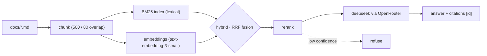

# Architecture — Ask the Docs

Production RAG: grounded answers with inline citations over a document corpus.

## Diagram

## Components

| Component | Responsibility |
|-----------|----------------|
| Chunker | Split on section boundaries with overlap |
| Retriever | BM25 + vector, fused with Reciprocal Rank Fusion |
| Reranker | Rescore the shortlist before generation |
| Agent | Grounded answer with inline citations |
| Evals | Retrieval recall gate in CI |

## Key decisions

- **Hybrid, not vectors-only** — IDs and numbers survive lexical search; paraphrases need vectors.
- **Citations, not trust** — every claim points to a chunk id, so answers are verifiable.
- **Gate in CI** — a deploy below the eval threshold is a fail, not a warning.
